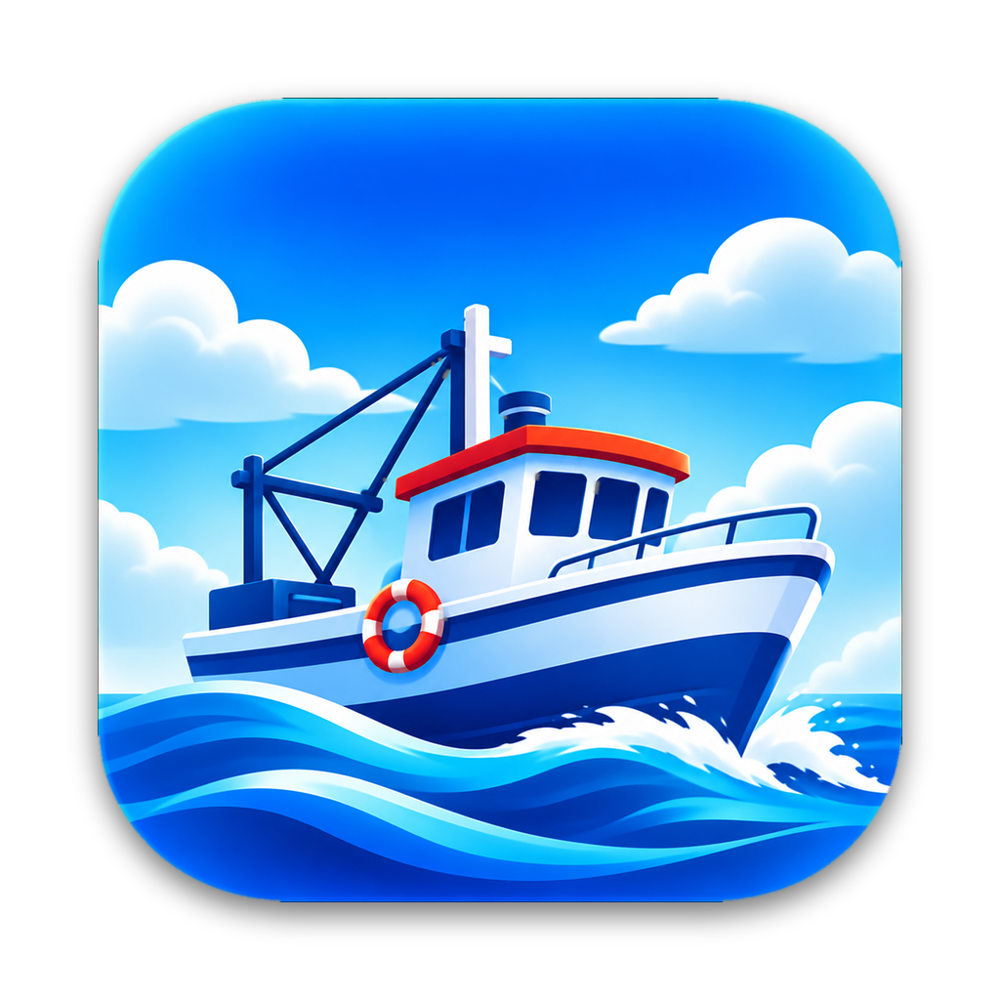

# Deck

macOS 15 Sequoia ve üzeri (Apple Silicon) için çift panelli, koyu temalı, tamamen Türkçe dosya yöneticisi. SwiftUI ile yazıldı.

<p align="center"></p>

## Depo yapısı

```
.
├── .github/workflows/Deck-build.yml   # GitHub Actions derleme iş akışı
├── Deck.swift                         # Uygulamanın tüm kodu
├── Deck.icns                          # Uygulama simgesi
├── Deck-icon-source.png               # Simgenin kaynak tasarımı (balıkçı teknesi)
├── Deck-icon-1024.png                 # macOS ızgarasına oturtulmuş 1024 px simge
├── Deck-Info.plist                    # Uygulama bilgileri, Türkçe yerelleştirme, izin metinleri
├── Deck-build.sh                      # Yerelde ve CI'da kullanılan derleme betiği
├── Deck-tools/Deck-make-icon.py       # Kaynak görselden .icns üreten betik (isteğe bağlı)
├── .gitignore                         # (GitHub bu adı şart koşar)
└── README.md                          # (GitHub bu adı şart koşar)
```

## Simgeyi yeniden üretme (isteğe bağlı)

Simgeyi değiştirmek isterseniz `Deck-icon-source.png` dosyasını yenisiyle değiştirip şunu çalıştırın
(Python 3 ve Pillow gerekir: `pip3 install pillow`):

```bash
cd Deck-tools
python3 Deck-make-icon.py ../Deck-icon-source.png ../Deck-icon-1024.png ../Deck.icns
```

## GitHub'da derleme

1. GitHub'da yeni bir depo açın.
2. Bu klasördeki **tüm dosyaları** (gizli `.github` klasörü dahil) depoya yükleyin.
   Web arayüzü dot-klasörlerini atlarsa *Add file → Create new file* deyip dosya adına
   `.github/workflows/Deck-build.yml` yazın ve içeriği yapıştırın. Git ile:
   ```bash
   git init
   git add .
   git commit -m "İlk sürüm"
   git branch -M main
   git remote add origin https://github.com/KULLANICI/DEPO.git
   git push -u origin main
   ```
3. **Actions** sekmesinde derleme kendiliğinden başlar (yaklaşık 2–4 dk).
4. Bitince çalıştırmanın sayfasında **Artifacts** bölümünden `Deck-macOS-arm64` dosyasını indirin (içinde `.zip` ve `.dmg` var).

Elle başlatmak için: **Actions → Derle (macOS Apple Silicon) → Run workflow**.

## Release (kalıcı indirme bağlantısı)

```bash
git tag v1.0
git push origin v1.0
```

Zip ve dmg **Releases** sayfasına otomatik eklenir.

## İndirilen uygulamayı açma

Uygulama Apple geliştirici hesabıyla imzalı değil (ad-hoc imza). macOS "hasarlı" ya da "doğrulanamadı" derse:

```bash
xattr -cr /Applications/Deck.app
```

ya da uygulamaya **sağ tıklayıp → Aç** deyin.

## Yerelde derleme

```bash
chmod +x Deck-build.sh
./Deck-build.sh
```

## Kullanım notları

- Klasöre **tek tıkla** girilir. Klasör seçmek için **⌘ + tıklama**; dosyalar tek tıkla seçilir, **⇧ + tıklama** aralık seçer.
- **Fareyle çoklu seçim:** bir dosyanın üzerinde fareyi/basılı tutun (yaklaşık yarım saniye), seçim modu açılır; basılı tutarak aşağı/yukarı sürükleyip birden çok dosya seçin. Seçim modundayken tek tıklama dosya/klasörü seçime ekler ya da çıkarır; seçim boşalınca mod kapanır.
- **ZIP** dosyasına çift tıklayınca, aynı yerde ZIP'in adını taşıyan klasöre çıkarılır.
- **Kopyala** ve **Taşı** etkin panelden diğer panele çalışır.
- Varsayılan sıralama: oluşturma tarihi, en yeni en üstte.
- Üst bar boş başlar. **Yer imleri** düğmesi seçili klasörü (seçili yoksa açık klasörü) üst bara ekler; barda zaten varsa kaldırır. Bardaki klasöre tıklayınca, en son tıkladığınız (etkin) panelde doğrudan açılır.
- Kısayollar: ⇧⌘N yeni klasör, ⌘⌫ sil, ⌘R yenile, ⌘[ geri, ⌘↑ üst klasör, ⌥⌘C kopyala, ⌥⌘M taşı.
